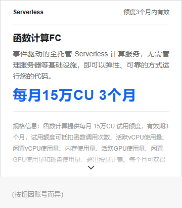

# ⛔ 控制台操作：领取函数计算新客试用套餐

```
╔══════════════════════════════════════════════════════════════════╗
║  PAUSE —— 这一步必须由人类在浏览器里完成，且只能做一次            ║
║                                                                  ║
║  agent 最多导航到位后停下。不得点击、不得重试、不得自动化。        ║
║  理由：这是**一次性资格**（见下），失败不可重来。                  ║
╚══════════════════════════════════════════════════════════════════╝
```

## 为什么必须人工，且只能一次

**【官方】** 「**同一用户仅能对同一产品申请试用一次**」。

**【官方】** 同一用户的判定是跨账号的：

> 同一用户是指根据不同阿里云账号在注册、登录、使用中的关联信息…
> 关联信息包括但不限于**同一证件号、同一手机号、同一支付账号、同一设备、同一地址**。

**所以「换个账号再试」也不行。**

而 FC 试用额度是这套方案里 `cdt-keeper` 兜底函数的成本来源。
**一个会「怀疑自己没点对、再点一次」的 agent，是在拿永久权益做试错。**

## 试用规则（四条硬门槛）

1. 已完成实名认证
2. **从未购买过**该产品（无 ≥0 元新购订单、无 >0 元后付费账单）
3. 账户无欠费
4. 同一用户仅一次

## 路径

1. 登录阿里云控制台
2. 进入 **函数计算 FC** 的「**新客试用套餐**」页面
3. 点「立即试用」
4. **按提示完成选配及开通** —— 注意这**不是一次点击**，是一个多步下单流
   （选配 → 勾协议 → 确认订单）



> 📌 上图只保留**卡片结构**（产品名、额度、规格说明）—— 按钮区已遮盖，
> 因为那一栏反映的是**某个账号当时**的资格状态，与页面结构无关。
>
> **新账号这里才会是「立即试用」。** 点之前先确认这确实是你想要的 ——
> 它是**一次性资格**，没有第二次。

## ⚠️ 一个实测风险

**【实测】** 该页面与相关试用入口加载了阿里云盾风控脚本（`baxiaCommon.js` + `sufei_data`）。

**遇滑块即停，不要试图通过。** 理由不只是技术难度 —— 那是**在对抗风控**，
对一套要公开的方案来说，教 agent 过风控是错误设计。

## 验收（agent 可做，只读）

领完之后核对**额度是否真的到账**：

| 检查 | 方法 |
|---|---|
| 额度到账 | 看账单里该小时 FC 的费用是否为 0（或 CU 是否计入免费额度） |
| 周期 | 15 万 CU / 周期 × 连续 3 个周期 |

> ⚠️ **不要用「页面显示领取成功」当验收** —— 以上面的账单核对为准。

## 如果没领到

**不影响守护本身。** 护闸（`cdtguard.py`）完全跑在 ECS 内部，与 FC 无关；
FC 只是「实例被意外停机时把它拉起来」的兜底。

**没领到的代价是**：FC 从免费额度变成按量付费 —— 按量付费有**每小时最低消费**
（¥0.01 × 有调用的小时数）。

⚠️ **但本方案的实际周期是 8 分钟一次**（`guard-liveness-8min` 存活巡检，见
[`../scripts/provision/README.md`](../scripts/provision/README.md) §5.3）——
**每小时都有调用 ⇒ 实付约 ¥7.9/月，不是 ¥0.33/月。**

> 这个钱值不值得花，取决于你要不要那个存活巡检：它是**唯一**能在护闸悄悄死掉时
> 告警的机制。想省钱就把周期改到 ≥1 天（¥0.33/月），代价是护闸死了你可能一天后才知道。

**见 [`../docs/pitfalls.md`](../docs/pitfalls.md) 第 5 条** ——
任何小于 1 小时的周期都会让成本变成 ¥7.9/月，**而调用量一模一样**。
