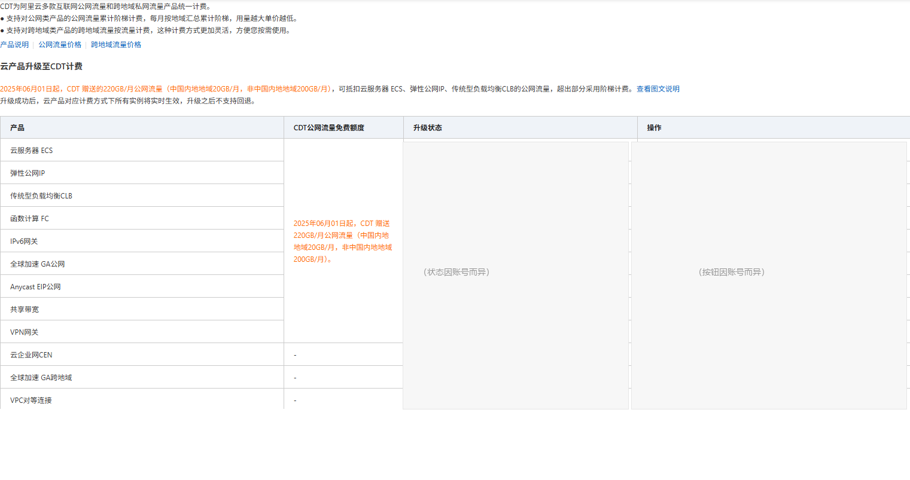

# ⛔ 控制台操作：升级至 CDT 计费

```
╔══════════════════════════════════════════════════════════════════╗
║  PAUSE —— 这一步必须由人类在浏览器里完成                          ║
║                                                                  ║
║  agent 不得执行、不得代点、不得用 Playwright 自动化这一步。        ║
║  理由：这是**不可逆的账号级变更**（见下）。                        ║
║  agent 可以做的：导航到页面、把本文件给用户看、在用户完成后核对结果。 ║
╚══════════════════════════════════════════════════════════════════╝
```

## 为什么必须人工

**【控制台】** 「云产品升级至 CDT 计费」页面上的原文（**下方那张截图里就能看到**）：

> 升级成功后，云产品对应计费方式下所有实例将实时生效，**升级之后不支持回退**。

（⚠️ **出处说明**：这句**不在帮助文档里** —— 核对过现行《升级至 CDT 计费》页面，
官方正文只写了「所有存量和新增的按流量计费实例将通过CDT统一计费和出账」，
**没有**任何一句说不可逆。结论成立、出处不同，所以本仓库把它标成
**【控制台】** 而不是【官方】。判据就是下面那张控制台截图，你可以自己核。）

以及【官方】：

> **所有存量和新增的**按流量计费实例将切换为 CDT 统一计费和出账。

**也就是说这一步会改掉账号上所有按流量计费业务的计费方式，不只这一台机器。**

## 什么时候需要做

**CDT 自 2024-12-12 起免开通** —— 「开通 CDT」这一步**不存在**，不需要做。

但「**把云产品升级至 CDT 计费**」是另一件事，且**分产品**：

| 产品 | 是否需要人工升级 |
|---|---|
| **EIP**（2024-12-17 0 点后首次创建） | 已直接由 CDT 出账，**不需要** |
| **EIP**（该时间点前创建过） | 仍走原计费规则，**可以**升级 |
| **ECS** | 官方列为「未升级」产品，**通常需要** |
| **共享带宽** | 官方与 ECS 并列，**通常需要** |

> ⚠️ 若公网出口由 **EIP 或共享带宽**承载（而不是 ECS 固定公网 IP），
> **可能完全不需要做这一步**。做之前先确认出口是哪个。

## 路径

1. 登录阿里云控制台 → **云数据传输 CDT**
2. 左侧找到「**云产品升级至 CDT 计费**」页面
3. 在目标产品（ECS / 共享带宽）那一行点「**去升级**」
4. 读完弹出的影响说明，确认



> 📌 上图只保留**页面结构**（产品清单、免费额度说明、列名）——
> **「升级状态」与「操作」两列已遮盖**，因为那两列反映的是**某个账号当时**的状态，
> 与页面结构无关。
>
> **对你自己**要看的就一件事：**承载公网出口的那个产品那一行**有没有出现
> 「去升级」。有，就说明还没升级，需要做这一步；没有，就说明已经是 CDT 计费了。
> 出口走共享带宽时，**ECS 那一行不需要动**（见上面的 ⚠️）。

## 验收（agent 可做，只读）

**不要只信「我点了所以成了」。** 用只读手段回读：

| 检查 | 方法 |
|---|---|
| 升级是否生效 | 看**账单**里是否出现 CDT 计费项（字段名见下），或控制台该页面该产品是否还显示「去升级」 |
| 额度是否可用 | 用 `ListCdtInternetTraffic` 看累计用量是否开始增长 |

> ⚠️ **账单里的 CDT 字段名取决于账号是 CDT 1.0 还是 2.0**，**别只照着一个名字找**：
>
> | | 商品 Code | 计费项 |
> |---|---|---|
> | CDT 1.0（2026-05-20 前） | `cdt_internet_public_cn` | `ECS_Out_Bytes`、`Eip_Out_Bytes`、`Cbwp_Out_Bytes` … |
> | CDT 2.0（2026-05-20 起**新账号默认**） | `cdt_DataTransfer_public_cn` | `internet_traffic` |
>
> **两者账单金额一致、免费额度也一致**——变的只是名字。
> 新账号**找不到** `cdt_internet_public_cn` 是**正常的**，不代表升级没生效。
> 见 [`../docs/billing.md`](../docs/billing.md) 第五节。

> ⚠️ **不要拿 ActionTrail 里的 `SwitchToCdt` / `OpenCdtService` 事件名当「有 API」的依据。**
> 那份文档自己写明「记录了用户通过 OpenAPI **或控制台等方式**操作时产生的管控事件」——
> **控制台点击同样产生这些事件**。它们是事件的证据，不是 API 的证据。

## 想留余量的话

升级后额度是 **220 GB/月**（中国内地 20 + 非中国内地 200）。

若你的机器在中国内地，**能用的只有 20 GB**，守护阈值要按地域取，
**不能写死一个数**。

> ✅ 守护已按这条实现：启动时从实例元数据读实测地域，自动取对应池子（内地 20 / 非内地 200），
> 预警线随之而动。见 [`../docs/billing.md`](../docs/billing.md) 第一节。
>
> ⚠️ 取不到实测地域时（非 ECS / 元数据不可达），守护按**更小的那个池子**守 ——
> 即内地额度 **20 GB**。**方向是「宁可早停，不可多烧」。**
> 早先这里是回落到 200，那是**反的**：内地实例会拿 200 GB 的阈值守着 20 GB 的池子。
> 要覆盖它，显式设 `TRAFFIC_THRESHOLD_GB`。
